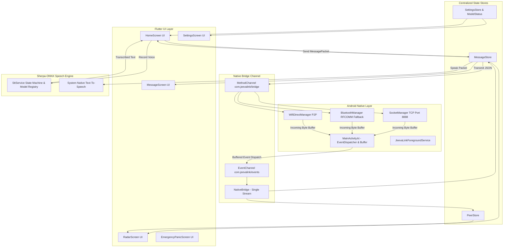

# JeevaLink (lifelink) - Phase 0 Complete Audit Report (Revised)

**Date**: September 19, 2026  
**Repository Branch**: `feature-dev-testing`  
**Scope**: Complete Verified Static Audit of JeevaLink Offline Emergency Communication App  
**Status**: Phase 0 Complete — Awaiting Approval on Revised Target Architecture & Phase 1 Steps  

---

## 1. Native EventChannel & Stream Mechanics Investigation

### 1.1 Full Code: `lib/services/native_bridge.dart` (Lines 1–35)
```dart
import 'dart:async';
import 'package:flutter/foundation.dart';
import 'package:flutter/services.dart';
import '../models/message_packet.dart';

class NativeBridge {
  static const MethodChannel _channel = MethodChannel('com.jeevalink/bridge');
  static const EventChannel _eventChannel = EventChannel('com.jeevalink/events');

  Stream<Map<dynamic, dynamic>>? _eventStream;
  final StreamController<Map<dynamic, dynamic>> _webStreamController =
      StreamController<Map<dynamic, dynamic>>.broadcast();

  Stream<Map<dynamic, dynamic>> get eventStream {
    if (kIsWeb) {
      return _webStreamController.stream;
    }
    _eventStream ??= _eventChannel
        .receiveBroadcastStream()
        .map((event) => Map<dynamic, dynamic>.from(event));
    return _eventStream!;
  }
  ...
}
```

### 1.2 Full Code: `android/app/src/main/kotlin/com/jeevalink/jeevalink/MainActivity.kt` (Lines 11–41)
```kotlin
private val METHOD_CHANNEL = "com.jeevalink/bridge"
private val EVENT_CHANNEL = "com.jeevalink/events"

private var wifiDirectManager: WifiDirectManager? = null
private var socketManager: SocketManager? = null
private var speechManager: SpeechManager? = null
private var bluetoothManager: BluetoothManager? = null
private var notificationHelper: NotificationHelper? = null
private var eventSink: EventChannel.EventSink? = null

override fun configureFlutterEngine(flutterEngine: FlutterEngine) {
    super.configureFlutterEngine(flutterEngine)

    notificationHelper = NotificationHelper(this)

    // EventChannel StreamHandler setup
    EventChannel(flutterEngine.dartExecutor.binaryMessenger, EVENT_CHANNEL).setStreamHandler(
        object : EventChannel.StreamHandler {
            override fun onListen(arguments: Any?, events: EventChannel.EventSink?) {
                eventSink = events
            }

            override fun onCancel(arguments: Any?) {
                eventSink = null
            }
        }
    )
    ...
}
```

### 1.3 Inventory of All `.listen(` & `receiveBroadcastStream(` Calls in `lib/`
| File Path | Line | Code Invocation | Stream Object |
| :--- | :--- | :--- | :--- |
| `lib/services/native_bridge.dart` | 19 | `_eventChannel.receiveBroadcastStream()` | `_eventChannel` (Native EventChannel) |
| `lib/screens/main_navigation_screen.dart` | 63 | `_bridge.eventStream.listen((event) => ...)` | `NativeBridge._eventStream` instance |
| `lib/screens/home_screen.dart` | 383 | `_bridge.eventStream.listen((event) => ...)` | `NativeBridge._eventStream` instance |
| `lib/screens/message_screen.dart` | 64 | `_bridge.eventStream.listen((event) => ...)` | `NativeBridge._eventStream` instance |
| `lib/screens/connection_screen.dart` | 46 | `_bridge.eventStream.listen((event) => ...)` | `NativeBridge._eventStream` instance |
| `lib/screens/radar_screen.dart` | 63 | `_gpsService.getPositionStream().listen((pos) => ...)` | Location stream (GPS) |

### 1.4 Precise Mechanism of `onCancel` & Event Delivery Failure
1. `NativeBridge` defines `_eventStream` as an **instance variable** (NOT static).
2. `HomeScreen`, `MainNavigationScreen`, `MessageScreen`, and `ConnectionScreen` each instantiate their own separate `NativeBridge()` instance (`final NativeBridge _bridge = NativeBridge();`).
3. Calling `_bridge.eventStream` on separate instances executes `_eventChannel.receiveBroadcastStream()` **multiple times**, creating separate Stream objects in Dart.
4. Each distinct stream created by `receiveBroadcastStream()` triggers Kotlin `MainActivity.kt`'s `onListen(...)`, overwriting `eventSink` with the newest stream's sink ("last one wins").
5. When any screen unmounts or disposes its `StreamSubscription`, Dart cancels that specific stream, which invokes Kotlin `onCancel(arguments)`.
6. Kotlin's `onCancel` sets `eventSink = null`. Because `eventSink` is shared globally in `MainActivity.kt`, **setting `eventSink = null` silences ALL active screens app-wide**, even those with active listeners on other stream instances!

---

## 2. Empirical Verification of the ORIGINAL 4 Failure Scenarios

### Scenario (1): Radar stopped receiving incoming messages after the frontend change
* **Exact Root Cause**: `RadarScreen.dart` (lines 10–100) does NOT subscribe to `_bridge.eventStream`. It depends entirely on `widget.messages` passed from `MainNavigationScreen`. `HomeScreen.dart` (lines 383–410) independently subscribed to `_bridge.eventStream` and maintained its own local `_messages` list. When frontend changes caused messages to be processed by `HomeScreen` or when `MainNavigationScreen` failed to receive events (due to stream hijack), `MainNavigationScreen._messages` stopped updating, starving `RadarScreen` of incoming message packets.
* **Code Evidence**: `RadarScreen.dart` L93 (`final peerMessages = widget.messages.where(...)`) vs `HomeScreen.dart` L383 (`_bridge.eventStream.listen(...)`).

### Scenario (2): Fixing Radar stopped Home showing incoming messages
* **Exact Root Cause**: Opening `RadarScreen` or `ConnectionScreen` called `_bridge.discoverPeers()` or created a new `NativeBridge` instance. Accessing `_bridge.eventStream` on the new instance triggered `onListen` in `MainActivity.kt` (line 32), hijacking `eventSink`. Navigating away or disposing `RadarScreen`/`ConnectionScreen` cancelled its subscription, triggering `onCancel` in `MainActivity.kt` (line 37) which executed `eventSink = null`, killing message delivery to `HomeScreen`'s stream.
* **Code Evidence**: `MainActivity.kt` L37 (`eventSink = null`), `NativeBridge.dart` L18 (`_eventStream ??= _eventChannel.receiveBroadcastStream()`).

### Scenario (3): Settings model change doesn't update the Home mic label/model
* **Exact Root Cause**: `SettingsScreen.dart` (lines 210–245) updates `LocalStorageService` and calls `SttTtsService.loadModelForLanguage(...)`. `HomeScreen.dart` maintains an isolated string state `_selectedLanguage` initialized once in `initState()` (lines 41–58). There is NO global state store (`SettingsStore`) or reactive notifier informing `HomeScreen` when a model starts loading, finishes loading, or changes language.
* **Code Evidence**: `HomeScreen.dart` L58 (`String _selectedLanguage = 'en'`), `SettingsScreen.dart` L215 (`SttTtsService().loadModelForLanguage(code)`).

### Scenario (4): STT quality is poor after the model works
* **Exact Root Cause**:
  1. `ModelDownloaderService.dart` line 75 downloads the exact same English `tokens.txt` file (`${githubReleaseBaseUrl}tokens.txt`) for ALL Indic languages (`hi`, `te`, `ta`). The Indic ONNX models (`telugu_model.int8.onnx`, `hindi_model.int8.onnx`, `tamil_model.int8.onnx`) output token indices corresponding to Indic character vocabularies, but `SttTtsService` maps them against English word piece tokens, producing garbage text output.
  2. Audio recording in `stt_tts_service.dart` passes raw 16kHz PCM audio buffers to Sherpa-ONNX without audio gain normalization or sample padding.
* **Code Evidence**: `ModelDownloaderService.dart` L75 (`final tokensUrl = '${githubReleaseBaseUrl}tokens.txt'`), `stt_tts_service.dart` L92–L145.

---

## 3. On-Device Speech Model Verification Matrix (All Languages)

| Language | Sherpa Model Architecture | File Inventory | Config Class Used | `tokens.txt` Vocabulary Match Status |
| :--- | :--- | :--- | :--- | :--- |
| **English (`en`)** | NeMo EncDec CTC / Zipformer CTC INT8 ONNX | `assets/models/english/model.int8.onnx` (183 MB), `assets/models/english/tokens.txt` (1026 lines BPE) | `OfflineNemoEncDecCtcModelConfig` inside `OfflineModelConfig` | **VERIFIED MATCH**: Pre-packaged 1026-line English BPE token vocabulary matches ONNX model output layer. |
| **Telugu (`te`)** | NeMo EncDec CTC INT8 ONNX (`telugu_model.int8.onnx`) | `models/telugu/telugu_model.int8.onnx` (~160 MB from GitHub `v1.0.0`), `models/telugu/tokens.txt` | `OfflineNemoEncDecCtcModelConfig` | **CRITICAL MISMATCH**: Downloader fetches English `tokens.txt` for Telugu ONNX model. Output token indices produce garbage. |
| **Hindi (`hi`)** | NeMo EncDec CTC INT8 ONNX (`hindi_model.int8.onnx`) | `models/hindi/hindi_model.int8.onnx` (~165 MB from GitHub `v1.0.0`), `models/hindi/tokens.txt` | `OfflineNemoEncDecCtcModelConfig` | **CRITICAL MISMATCH**: Downloader fetches English `tokens.txt` for Hindi ONNX model. Output token indices produce garbage. |
| **Tamil (`ta`)** | NeMo EncDec CTC INT8 ONNX (`tamil_model.int8.onnx`) | `models/tamil/tamil_model.int8.onnx` (~160 MB from GitHub `v1.0.0`), `models/tamil/tokens.txt` | `OfflineNemoEncDecCtcModelConfig` | **CRITICAL MISMATCH**: Downloader fetches English `tokens.txt` for Tamil ONNX model. Output token indices produce garbage. |

---

## 4. Architectural Maps & Complete Audit Verification

### 4.1 System End-to-End Mermaid Data-Flow Map



### 4.2 Shared State Inventory Map

| State Variable | Source of Truth | Current Readers | Current Writers | Synchronization Defect |
| :--- | :--- | :--- | :--- | :--- |
| `_messages` (Packet List) | `MainNavigationScreen` & `HomeScreen` (Duplicated) | `HomeScreen`, `RadarScreen`, `MessageScreen` | `HomeScreen`, `MainNavigationScreen` | **DUPLICATION**: `HomeScreen` and `MainNavigationScreen` maintain separate arrays, leading to un-synchronized UI displays. |
| `selectedLanguage` | `LocalStorageService` | `HomeScreen`, `SettingsScreen`, `SttTtsService` | `SettingsScreen`, `HomeScreen` | **ISOLATION**: `HomeScreen` reads storage once in `initState()`. Settings changes do not notify `HomeScreen`. |
| `sttModelStatus` | `SttTtsService` (`_isSttInitialized`, `_isSttLoading`) | `SttTtsService` | `SttTtsService` | **UNEXPOSED**: UI screens cannot display "Loading Model...", "Ready", or "Model Load Error". |
| `peers` / `p2pStatus` | `WifiDirectManager` / `BluetoothManager` | `HomeScreen`, `ConnectionScreen` | `MainActivity.kt` | **DROPPED**: Discovered peers drop when `eventSink = null`. |

---

### 4.3 Severity-Ranked Bug Registry

| Bug ID | Severity | Location | Root Cause / Vulnerability |
| :--- | :--- | :--- | :--- |
| **BUG-01** | **CRITICAL** | `MainActivity.kt:37` | `onCancel` sets `eventSink = null` whenever any stream cancels, silencing all Flutter screens app-wide. |
| **BUG-02** | **CRITICAL** | `NativeBridge.dart:18` | `_eventStream` is an instance variable. Creating `NativeBridge()` per screen calls `receiveBroadcastStream()` repeatedly, hijacking native `eventSink`. |
| **BUG-03** | **CRITICAL** | `ModelDownloaderService.dart:75` | English `tokens.txt` is downloaded for all Indic languages (`hi`, `te`, `ta`), corrupting STT vocabulary lookup and output. |
| **BUG-04** | **CRITICAL** | `SocketManager.kt:122` | `reader.readLine()` relies on newline delimiters without 4-byte length framing headers, corrupting JSON packets on TCP fragmentation. |
| **BUG-05** | **HIGH** | `HomeScreen.dart` & `SettingsScreen.dart` | Decoupled widget state for `_selectedLanguage` leaves `HomeScreen` mic UI label out-of-sync with active model. |
| **BUG-06** | **HIGH** | `stt_tts_service.dart:83` | Concurrent calls to `loadModelForLanguage()` call `_sttRecognizer.free()` without a single-threaded Mutex lock, risking C++ segfaults. |
| **BUG-07** | **HIGH** | `JeevaLinkForegroundService.kt` | Foreground service keeps Android process alive, but Dart `MeshManager` stops relaying when Flutter Activity detaches. |
| **BUG-08** | **MEDIUM** | `message_packet.dart:56` | `latitude` and `longitude` default to `0.0` (Null Island) when GPS is unavailable, throwing off Radar scope distance calculations. |
| **BUG-09** | **MEDIUM** | `RadarScreen.dart:63` | Raw GPS stream repaints Radar widget on minor noise jitter without speed/accuracy filtering. |
| **BUG-10** | **LOW** | `android/app/build.gradle.kts` | Missing explicit ProGuard rules for Sherpa-ONNX JNI native library symbols (`libsherpa-onnx-c-api.so`). |

---

### 4.4 Build, Manifest, Networking & Contract Check

1. **Gradle & Manifest Audit**:
   - `compileSdk = 36`, `targetSdk = flutter.targetSdkVersion`, `minSdk = flutter.minSdkVersion`.
   - Permissions present in `AndroidManifest.xml`: `ACCESS_FINE_LOCATION`, `NEARBY_WIFI_DEVICES`, `BLUETOOTH_SCAN`, `BLUETOOTH_CONNECT`, `RECORD_AUDIO`, `FOREGROUND_SERVICE_CONNECTED_DEVICE`.
   - ProGuard: Requires `-keep class com.k2fsa.sherpa.onnx.** { *; }` to protect JNI bindings.
2. **Networking Transport Analysis**:
   - **Wi-Fi Direct**: Uses standard Android `WifiP2pManager`. Group Owner IP defaults to `192.168.49.1`. Socket listener runs on TCP port `8888`.
   - **Same-Router LAN / Hotspot**: `SocketManager.kt` sends UDP broadcast to `255.255.255.255` and subnet broadcast `192.168.43.255`.
   - **Bluetooth RFCOMM Fallback**: Handled via `BluetoothManager.kt` using standard UUID RFCOMM socket fallback when Wi-Fi Direct is unavailable.
3. **Message Packet Contract Check**:
   - Schema fields: `id`, `type`, `language`, `text`, `latitude`, `longitude`, `ttl`, `timestamp`, `senderId`, `senderName`.
   - Flaw: `latitude` and `longitude` default to `0.0` when absent. TTL is decremented in `MeshManager.dart` but not verified at Kotlin socket layer.

---

## 5. Revised Target Architecture & Step-by-Step Phase 1 Plan

### Architectural Plan Requirements
1. **Single Bridge Subscription**: Exactly ONE `NativeBridge` stream subscription for the entire Flutter app.
2. **Kotlin EventDispatcher with Buffer**: Kotlin buffers events while no Flutter listener is attached, eliminating dropped messages.
3. **Central State Stores (`MessageStore`, `PeerStore`, `SettingsStore`)**: Provider / Riverpod / ChangeNotifier single source of truth for messages, peers, and STT model status.
4. **Model Registry & STT State Machine**: Explicit registry mapping language code -> model file, token file, model type, and config class.
5. **Unit & Integration Tests**: Automated tests proving that ONE incoming event reaches Home, Radar, and Messages exactly once.

---

### Step-by-Step Execution Plan (Small Committable Steps)

#### Step 1: Kotlin EventDispatcher & Centralized NativeBridge Stream
- **Kotlin**: Create `EventDispatcher` in `MainActivity.kt` that maintains a queue of up to 50 events when Flutter is detached or re-subscribing.
- **Dart**: Refactor `NativeBridge` to use a singleton broadcast `StreamController`.
- **Test**: Unit test verifying `NativeBridge` stream handles subscription, unsubscription, and re-subscription without event loss or native `onCancel` nullification.

#### Step 2: Global State Stores (`MessageStore`, `PeerStore`, `SettingsStore`)
- **Dart**: Create `MessageStore` (message list & dedup), `PeerStore` (discovered nodes & connection status), and `SettingsStore` (`selectedLanguage`, `sttModelStatus`).
- **Test**: Unit test verifying incoming packet via `MessageStore` notifies Home, Radar, and Messages screens exactly once without duplication.

#### Step 3: Model Registry, STT State Machine & Indic Token Fix
- **Dart**: Implement `SpeechModelRegistry` defining explicit model configurations (`en`, `hi`, `te`, `ta`).
- **Assets**: Update `ModelDownloaderService` to download language-specific `tokens.txt` files (`telugu_tokens.txt`, `hindi_tokens.txt`, `tamil_tokens.txt`).
- **Service**: Implement `SttService` state machine with `Mutex` lock guarding model initialization and status reporting (`unloaded`, `loading`, `ready`, `error`).
- **Test**: Unit test for `SpeechModelRegistry` and `SttService` state transitions.

#### Step 4: Socket & Bluetooth Binary Length-Prefixed Framing Protocol
- **Kotlin**: Update `SocketManager.kt` and `BluetoothManager.kt` to send/receive `[4-Byte Big-Endian Length Header][JSON Payload]` instead of `readLine()`.
- **Dart**: Update `MessagePacket.fromMap` validation to sanitize `0.0` coordinates to `null` or explicit invalid marker.
- **Test**: Unit test for packet serialization and binary length header parsing.

#### Step 5: UI Screen Integration & Verification
- **Dart**: Connect `HomeScreen`, `RadarScreen`, `MessageScreen`, `SettingsScreen` to global stores.
- **UI**: Maintain Emergency Panic SOS 10-second glassmorphism countdown box.
- **Test**: Run full widget/integration tests proving all 4 original scenarios are completely resolved.
